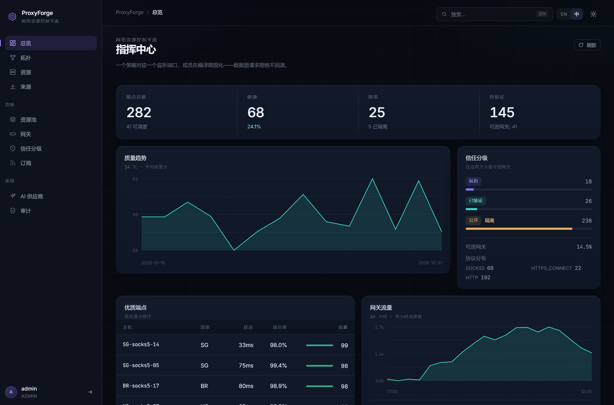
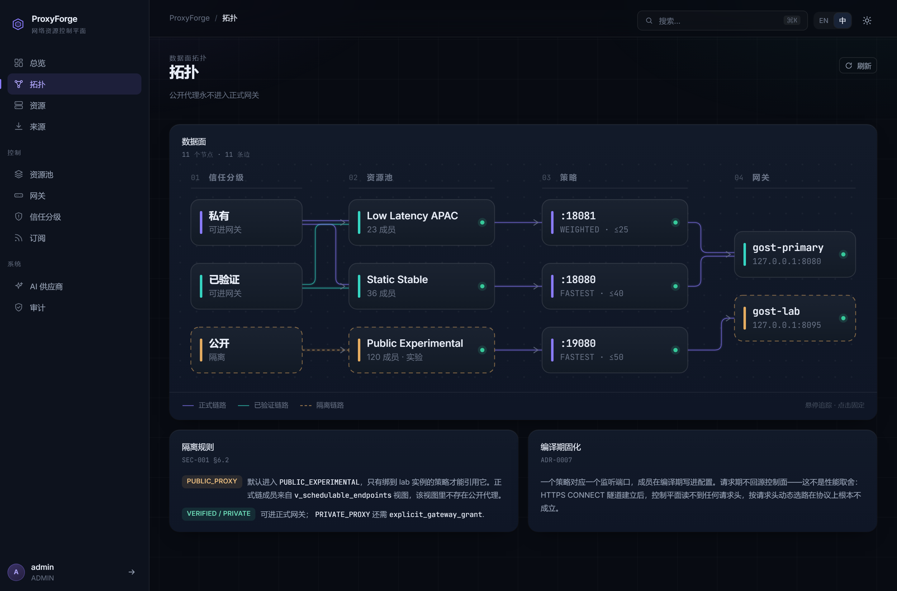
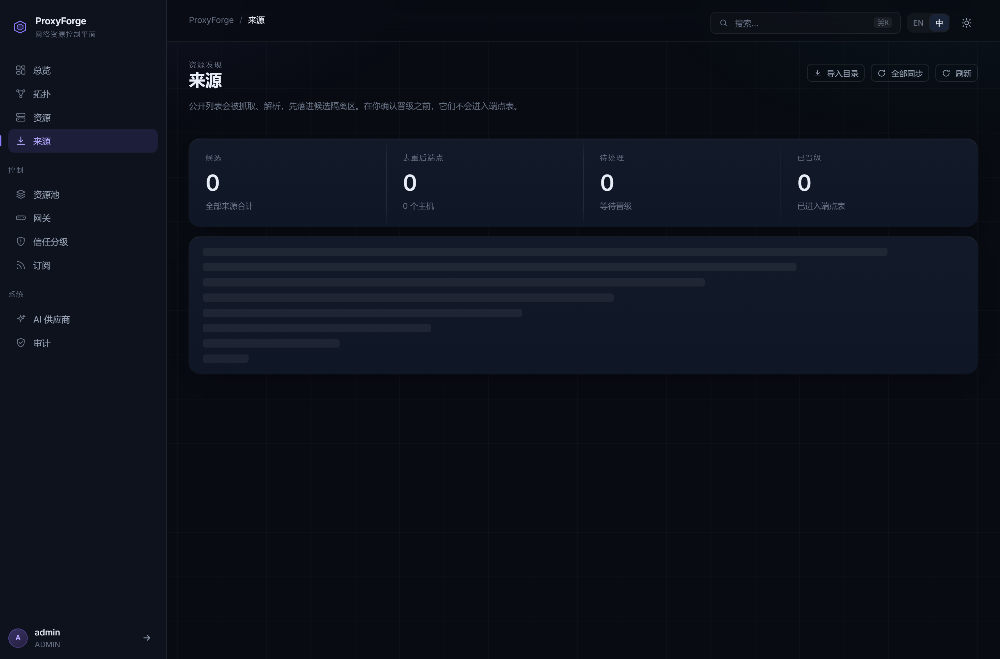
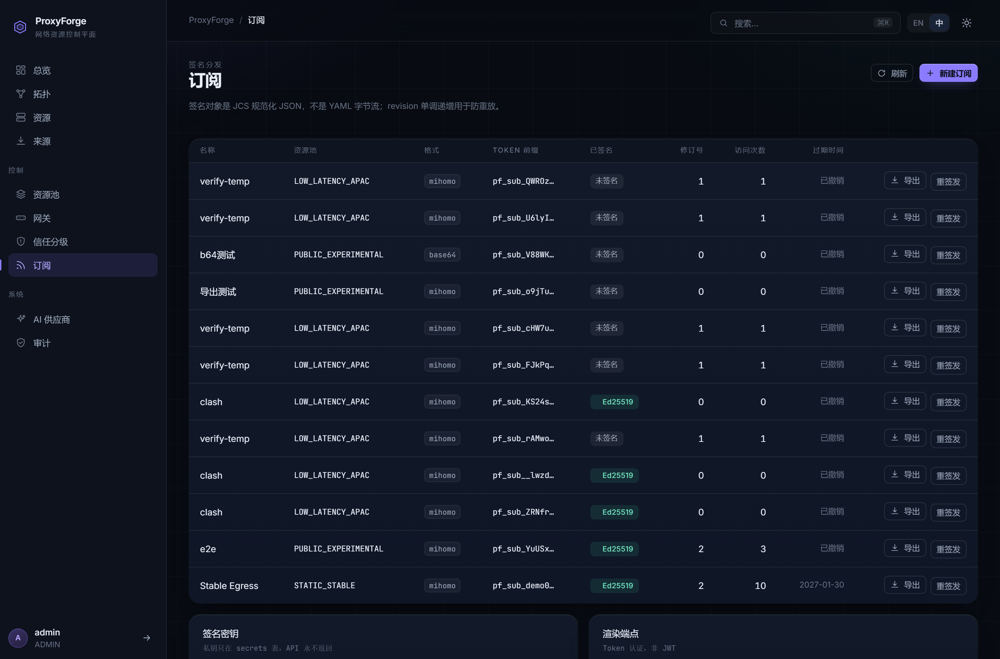
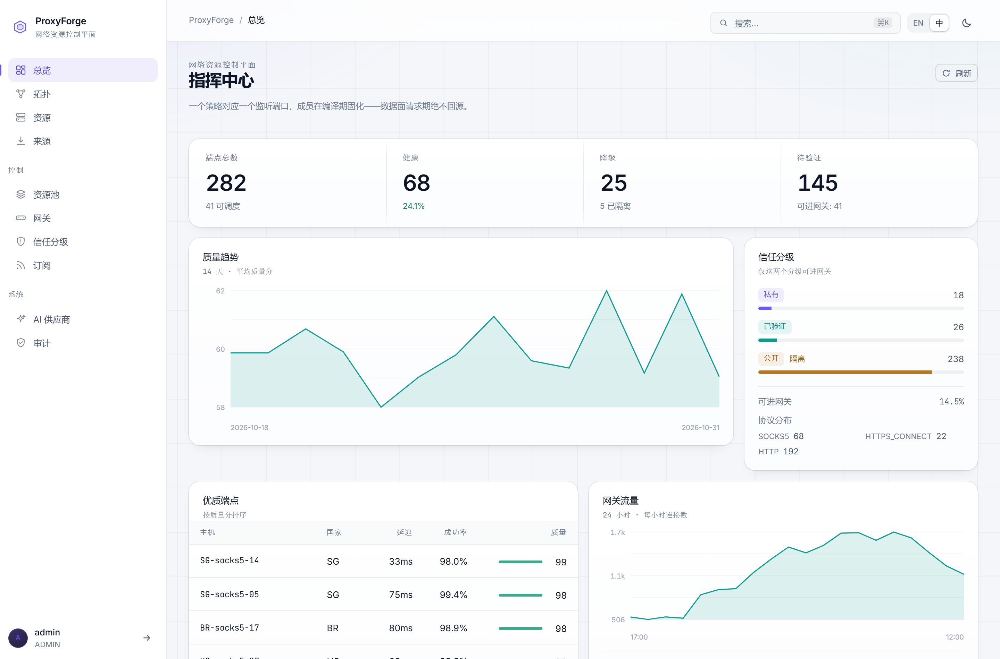
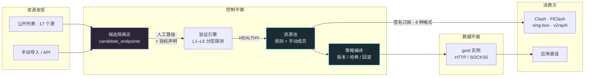

<div align="center">

# ProxyForge

**从零散代理资源，到可管理、可调度、可观测的网络出口基础设施**

发现 → 验证 → 分级 → 编组 → 下发

[](https://www.typescriptlang.org/)
[](https://nodejs.org/)
[](https://fastify.dev/)
[](https://react.dev/)
[](https://www.postgresql.org/)
[](LICENSE)
[](#项目状态)

[快速开始](#快速开始) · [界面](#界面) · [核心能力](#核心能力) · [架构](#架构) · [资源从哪来](#资源从哪来) · [文档](#文档索引)

</div>

---

## 这是什么

ProxyForge **不是**另一个 Clash 客户端，也**不是**免费 IP 列表收集器。

它回答的是另一个问题：

> 如何持续发现**有授权**的网络出口资源，验证它们的真实质量，按场景编组，并以统一、可审计、可签名的方式分发给应用？

市面上的代理工具大多止步于「导入订阅 → 选一个节点」。ProxyForge 把代理当作**基础设施资产**来管理：每个端点有生命周期、有健康历史、有信任分级、有授权依据，池成员随健康态自动漂移，最终以签名订阅或网关配置的形式交付。

<table>
<tr><td width="50%" valign="top">

**它做的事**

- 从 17 个公开源批量采集，多格式解析
- 候选隔离区 → 人工晋级 → 分层验证
- 健康态驱动的资源池自动重算
- 策略编译 + 版本化下发 + 回滚
- 订阅签名（Ed25519 over JCS），可离线验签
- 四种格式导出：Clash / sing-box / base64 / plain

</td><td width="50%" valign="top">

**它不做的事**

- 不解析 `ss://` `vmess://` `trojan://` `vless://`
- 不自动把公开代理提升到生产池
- 不伪造数据：界面上的每个数字都来自真实探测
- 不内置代理转发引擎（gost 为外部依赖）

</td></tr>
</table>

---

## 界面

深色为主、浅色可选，中英双语。所有数据来自真实接口，没有装饰性假数据。

<p align="center">
  
</p>

<table>
<tr>
<td width="50%"></td>
<td width="50%"></td>
</tr>
<tr>
<td align="center"><sub><b>拓扑</b> · 悬停追踪、点击固定，边按语义着色</sub></td>
<td align="center"><sub><b>来源采集</b> · 一键导入目录、全量同步、批量晋级</sub></td>
</tr>
</table>

<table>
<tr>
<td width="50%"></td>
<td width="50%"></td>
</tr>
<tr>
<td align="center"><sub><b>订阅</b> · 一次性 Token、重签发、四种格式导出</sub></td>
<td align="center"><sub><b>浅色主题</b> · 同一套设计语言</sub></td>
</tr>
</table>

---

## 核心能力

| 能力 | 说明 |
| --- | --- |
| **资产分层建模** | `ip_assets` / `proxy_endpoints` / `proxy_nodes` / 供应商账户分离，同一 IP 的多个端口是不同的端点，同一端点的多个节点是不同的接入方式 |
| **多格式采集** | 纯文本、JSON、CSV 三种抽取器；自动探测格式；支持 `host:port`、`host:port:user:pass`、`scheme://…`、`host:port:Country` 四种行形态 |
| **候选隔离区** | 解析器与 AI **只能写 `candidate_endpoints`**，晋级是进入端点表的唯一入口 |
| **分层验证** | L1 DNS → L2 TCP → L3 协议握手 → L4 认证 → L5 出口验证 → L6 质量采样，失败层级精确到原因 |
| **健康态驱动** | `PENDING_VERIFICATION → VERIFIED → HEALTHY`，连续成功 ≥2 才进池；失败自动降级并退出池成员 |
| **信任分级** | `PRIVATE_PROXY` / `VERIFIED_PROXY` / `PUBLIC_PROXY` 三级，**公开代理默认隔离，永不自动提级** |
| **资源池 + 策略编译** | 池成员按规则自动重算；策略编译成网关配置，带版本、哈希、回滚 |
| **签名订阅** | Token 认证（库里只存 SHA-256）+ Ed25519 签名 JCS 规范化 JSON，附公钥分发端点 |
| **四种导出格式** | Mihomo/Clash YAML · sing-box JSON · Base64 订阅 · 明文 URI 列表，节点集合严格一致 |
| **全链路审计** | 每个写操作落 `audit_events`，事件走 outbox 模式，可追溯「谁在什么时候改了哪条授权」 |

---

## 架构

模块化单体：模块边界即未来的服务边界，拆分不需要重写。



**关键不变量**（写在代码里，不是文档里）：

1. 解析器与 AI **只能写候选区** —— 晋级是唯一入口，且必须经过授权判断
2. 订阅取数走 `v_subscription_eligible_endpoints` 视图 —— `authorization_status` 不是 `AUTHORIZED`/`RESTRICTED` 的端点，**即使健康也不会出现在任何订阅里**
3. 签名对象是 **JCS 规范化 JSON**，不是 YAML 字节流 —— YAML 序列化不唯一，签字节流必然在客户端验签失败
4. 私钥只存 `secrets` 表密文（AES-256-GCM），API 永不返回
5. 网关只监听回环地址，`allow-lan: false` 写死在订阅渲染器里

---

## 快速开始

需要 **Node 22+**。本地用 PGlite（PostgreSQL 16 编译到 WASM），无需安装数据库。

```bash
git clone https://github.com/funny8kids/ProxyForge.git
cd ProxyForge
npm install

npm run db:reset    # 建库 + 迁移 + 种子数据
npm run dev         # API :8081 + Web :5173
```

打开 http://localhost:5173 ，用种子账号登录：

```
admin / proxyforge
```

> 种子数据是**确定性的演示数据**（122 个端点、3 个资源池、网关配置骨架）。
> 想看真实规模，进「来源」页点「导入目录」再点「全部同步」——会从 17 个公开源拉取 4 万余条候选。

常用命令：

```bash
npm run typecheck   # 三个 workspace 全量类型检查
npm run build       # contracts → api → web
npm run verify      # 38 项端到端自检（鉴权/订阅/幂等/错误模型…）
```

切换真实 PostgreSQL：改 `apps/api/src/config.ts` 里的 `databaseUrl` 一处即可，schema 与迁移完全兼容。

---

## 资源从哪来

「来源」页内置 17 个**实测可达**的公开代理列表，覆盖 HTTP / SOCKS4 / SOCKS5 与 text / JSON / CSV 三种格式。

一次全量同步的实测结果（2026-11）：

| 指标 | 数值 |
| --- | --- |
| 源 | 17 |
| 原始行 | 44,263 |
| 候选 | 44,529 |
| **去重后独立端点** | **24,862**（重复率 44%） |
| 独立 IP | 15,442 |
| 全量同步耗时 | **20.5 秒** |

协议分布：`SOCKS5 10,846` · `HTTP 9,292` · `SOCKS4 3,827` · `HTTPS_CONNECT 897`

**但数量不等于可用量。** 抽 150 条候选晋级后跑真实验证：**20 通过 / 130 失败，存活率 13.3%**（约 60 秒，8 并发）。三个可用出口实测落在东京、班加罗尔、圣克拉拉。

所以界面上三个数字是分开显示的 —— 候选总数、去重后、待处理。把 44,529 当成「有 4 万个可用代理」是最容易犯的误判。

> 公开列表里混着蜜罐和被入侵的主机。晋级要求显式勾选授权声明（写审计日志），验证通过才进池，这是流程上不可跳过的一步。

---

## 订阅导出

同一份节点集合，四种序列化方式。**换格式不改变 `revision`** —— 格式只是展示层，不是内容变更。

| 格式 | 产物 | 客户端 |
| --- | --- | --- |
| `mihomo` / `clash` | YAML **整份配置** | Clash Verge · FlClash · Mihomo Party · OpenClash |
| `singbox` | JSON **整份配置** | sing-box 内核 · Clash Verge Rev · FlClash |
| `base64` | URI 列表的 Base64 | v2rayN · Shadowrocket · 通用订阅格式 |
| `plain` | 明文 URI 列表 | 人工查看 / 粘到别处 |

三种获取方式：

```bash
# 1. 客户端按 URL 拉取（Token 认证）
GET /api/v1/subscriptions/{token}

# 2. 临时换格式 / 触发下载
GET /api/v1/subscriptions/{token}?format=singbox&download=1

# 3. 管理端导出（JWT 认证，不依赖明文 token）
GET /api/v1/subscriptions/{id}/export?format=base64
```

第 3 条是刻意加的：明文 Token 只在创建时出现一次，刷新页面后就再也拼不出下载地址了 —— 没有这条路径，想导出只能重建订阅，会丢掉访问计数与版本历史。

生成的 YAML 是**完整可用配置**，不是片段：`mixed-port` / `mode: rule` / `ipv6` / `url-test` 组带 `lazy: true` 都在。带认证的节点会写出 `username` / `password`，YAML 标量做了引号转义（`p@ss:word#1` 这种密码不会把配置写坏）。

---

## 安全模型

```
┌─────────────────────────────────────────────────────────┐
│  授权状态是硬门槛，不是建议                                │
├─────────────────────────────────────────────────────────┤
│  UNKNOWN     → 导入默认值，被所有订阅过滤                  │
│  AUTHORIZED  → 用户显式声明（写审计），可进入订阅           │
│  RESTRICTED  → 有条件可用                                 │
│  REVOKED     → 连带吊销生命周期                            │
└─────────────────────────────────────────────────────────┘
```

- **三级信任**：`PRIVATE_PROXY` > `VERIFIED_PROXY` > `PUBLIC_PROXY`。提级必须走**晋升建议 + 他人复核**，AI 只能建议
- **公开代理默认最严分级**：从公开源采集的端点一律 `PUBLIC_PROXY` + `UNKNOWN`，批量晋级也不能改变分级
- **订阅签名**：Ed25519 over JCS。响应头 `X-PF-Signature` / `X-PF-Revision` / `X-PF-Canonical-Hash`，公钥在 `/.well-known/proxyforge-signing-keys.json`
- **Token 不可逆**：库里只存 `sha256(token)`，重签发立即让旧 URL 失效
- **枚举防护**：不存在 / 已撤销 / 已过期三种情况统一返回 404

---

## 技术栈

| 层 | 选型 | 理由 |
| --- | --- | --- |
| 运行时 | Node 22 + TypeScript（strict） | 前后端同语言，契约可共享类型 |
| API | Fastify 5 | 路由树快、schema 校验原生、插件边界清晰 |
| 数据库 | PGlite（PG 16 → WASM） | 零安装启动；切真 PG 只改一个配置项 |
| 前端 | React 18 + Vite | 十屏控制台，无路由库（hash 路由足够） |
| 契约 | `packages/contracts` | 单一真相层，前后端共用同一份类型定义 |
| 签名 | Ed25519 + JCS | 规范化 JSON 保证跨语言验签一致 |

---

## 项目结构

```
ProxyForge/
├── apps/
│   ├── api/src/
│   │   ├── modules/          # 13 个业务模块（auth/resource/source/verification/pool/…）
│   │   ├── shared/           # parser · extract · crypto · jcs · sources-catalog
│   │   ├── db/               # client · migrate · seed · reset
│   │   └── worker/           # 验证调度 · 池重算 · 分区维护 · outbox 投递
│   └── web/src/
│       ├── screens/          # 10 个屏
│       ├── components/       # Icon · ui · CommandPalette
│       └── lib/              # api · i18n · format · useAsync
├── packages/contracts/       # 前后端共享类型
├── migrations/               # 4 个增量迁移
├── docs/
│   ├── architecture/         # 系统架构 · 模块设计 · 运行时流程
│   ├── decisions/            # 12 份 ADR
│   ├── database/             # 数据模型 · schema
│   ├── security/             # 安全设计（SEC-001）
│   └── screenshots/
└── scripts/                  # dev 编排 · verify · 截图回归
```

---

## 项目状态

**Alpha** —— 主干链路已跑通并通过 38 项自检，接口与数据模型仍可能调整。

| 已实现 | 骨架 / 外部依赖 | 规划中 |
| --- | --- | --- |
| 多格式采集（17 源） | 网关转发引擎（gost 需外部部署，配置编译与下发已完成） | AI 主动发现 |
| 候选隔离 + 批量晋级 | AI Provider 注册表（只有注册，未接业务） | L7 长周期稳定性编排 |
| L1–L6 分层验证 | | 多租户隔离 |
| 资源池 + 策略编译 + 回滚 | | 分级化探测调度 |
| 签名订阅 + 4 种导出 | | 出口 IP 漂移告警 |
| 审计 + 事件 outbox | | 通知渠道 |
| 10 屏控制台（中英双语 / 深浅主题） | | |

---

## 文档索引

| 文档 | 内容 |
| --- | --- |
| [系统架构](docs/architecture/01-system-architecture.md) | 三平面划分、部署形态、失败隔离 |
| [模块设计](docs/architecture/02-module-design.md) | 13 个模块的职责与边界 |
| [运行时流程](docs/architecture/03-runtime-flows.md) | 导入 / 验证 / 编译 / 订阅四条主链路 |
| [数据模型](docs/database/01-data-model.md) | 表关系与不变量 |
| [API 设计](docs/api/01-api-design.md) | RFC 9457 错误模型、分页、幂等 |
| [安全设计](docs/security/01-security-design.md) | 信任分级、授权门槛、签名方案 |
| [ADR 目录](docs/decisions/) | 12 份架构决策记录 |

---

## 贡献

这是一个个人项目，仍在快速演进。欢迎提 Issue 讨论设计取舍 —— 尤其是验证策略、池规则和签名协议这几块。

```bash
npm run typecheck && npm run verify   # 提交前请确保这两条通过
```

---

<div align="center">
<sub>MIT License · 用 TypeScript 写的基础设施，不追求功能数量，追求每个数字都可信</sub>
</div>
