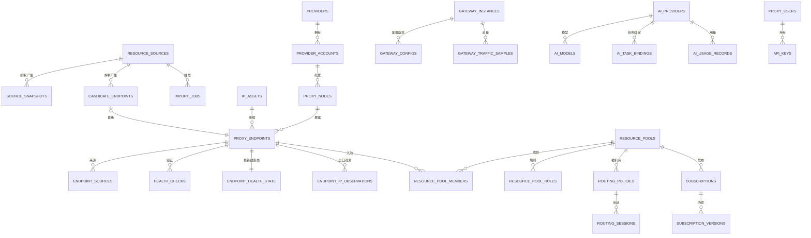

# ProxyForge 数据模型设计

> 文档编号：DATA-001
> 版本：v1.0 · 状态：Accepted
> 配套 DDL：[`schema-v1.sql`](./schema-v1.sql)（可直接在 PostgreSQL 16 执行）
> 关联：[系统架构](../architecture/01-system-architecture.md) · [模块设计](../architecture/02-module-design.md)

---

## 1. 建模原则

| # | 原则 | 落地方式 |
| --- | --- | --- |
| 1 | IP、节点、端点、供应商是**四种资产**，不是一张表 | `ip_assets` / `proxy_nodes` / `proxy_endpoints` / `provider_accounts`，各自独立状态机 |
| 2 | 属性维度拆开，不用一个 `type` 表达所有语义 | `ip_type`（静态/动态）、`network_type`（住宅/机房）、`protocol`、`origin_type`、`authorization_status` 五列独立 |
| 3 | 推断必须可识别 | 所有推断列配 `*_confidence` 或 `inferred` 布尔，`UNKNOWN` 是合法值 |
| 4 | 凭据不进业务表 | 业务表只存 `credential_ref`，明文在 `secrets` 中 AES-GCM 加密 |
| 5 | 健康结果保留历史，最新态单独物化 | `health_checks`（分区，历史）+ `endpoint_health_state`（1:1，最新） |
| 6 | 时间序列按时间分区 | `health_checks`、`endpoint_metrics_hourly`、`gateway_traffic_samples`、`audit_events` |
| 7 | 一个端点可来自多个来源 | 关联表 `endpoint_sources`（多对多），`proxy_endpoints.source_id` 只表示"首次发现来源" |
| 8 | 池成员区分自动/手工 | `resource_pool_members.source` + `suppressed`（手工成员不删除，只抑制） |
| 9 | 所有可配置实体带 `version` 与审计 | 乐观锁 `version` + `config_versions` + `audit_events` |
| 10 | 主键用 UUID v7（时间有序） | 应用侧生成，避免索引碎片与分布式冲突 |

### 1.1 ID 策略

- 业务实体：`uuid`（v7，应用侧生成，Java 用 `Uuid7` 实现或 `uuid-ossp` 的 v4 + 时间前缀方案）。
- 高写入日志表：`bigserial`（`health_checks`、`audit_events`、`gateway_traffic_samples`、`ai_usage_records`）。
- 不用 `serial` 做业务主键：导入/合并/多环境同步时会冲突。

---

## 2. 实体关系



---

## 3. 枚举字典

数据库使用 PostgreSQL 原生 ENUM（类型安全、索引更小）。新增值用 `ALTER TYPE ... ADD VALUE`，**只增不删不改名**；改名通过"新值 + 数据迁移 + 保留旧值"完成。

| 枚举 | 取值 | 说明 |
| --- | --- | --- |
| `ip_type` | `STATIC` `DYNAMIC` `UNKNOWN` | 只依据观测证据判定 |
| `network_type` | `RESIDENTIAL` `DATACENTER` `MOBILE` `UNKNOWN` | 来源声明优先，ASN 推断标 `inferred` |
| `confidence` | `DECLARED` `OBSERVED` `INFERRED` `UNKNOWN` | 属性可信度 |
| `proxy_protocol` | `HTTP` `HTTPS_CONNECT` `SOCKS4` `SOCKS5` | `HTTPS_CONNECT` 指需 TLS 到代理本身 |
| `origin_type` | `OWNED` `FREE_PROVIDER` `PUBLIC_PROXY` `PAID_PROVIDER` | 资源来源性质 |
| `authorization_status` | `AUTHORIZED` `RESTRICTED` `UNKNOWN` `REVOKED` | **硬门槛**：`UNKNOWN`/`REVOKED` 不得进入正式池 |
| `trust_tier` | `PRIVATE_PROXY` `PUBLIC_PROXY` `VERIFIED_PROXY` | **信任分级**：决定"能用在什么场景"，与授权状态正交（见 §5.2） |
| `lifecycle_status` | `DISCOVERED` `PENDING_VERIFICATION` `VERIFIED` `HEALTHY` `DEGRADED` `UNAVAILABLE` `QUARANTINED` `REJECTED` `REVOKED` | 见 §5 状态机 |
| `node_kind` | `VPS` `ROUTER` `CONTAINER` `MANAGED_SERVICE` `UNKNOWN` | — |
| `node_status` | `ACTIVE` `INACTIVE` `UNREACHABLE` `DECOMMISSIONED` | — |
| `source_type` | `GITHUB_REPO` `WEB_PAGE` `API` `CSV_FEED` `MIHOMO_SUB` `MANUAL` | — |
| `job_status` | `PENDING` `RUNNING` `SUCCEEDED` `FAILED` `CANCELLED` | 任务租约通用 |
| `review_status` | `PENDING` `PROMOTED` `REJECTED` `DUPLICATE` | 候选审核 |
| `member_source` | `AUTO` `MANUAL` | 池成员来源 |
| `policy_strategy` | `DIRECT` `FIXED` `FASTEST` `WEIGHTED` `STICKY` `FAILOVER` `REGION` | — |
| `gateway_config_status` | `DRAFT` `COMPILED` `APPLIED` `FAILED` `SUPERSEDED` `ROLLED_BACK` | — |
| `check_failure_reason` | `NONE` `DNS_FAILURE` `TCP_REFUSED` `TCP_TIMEOUT` `TLS_ERROR` `PROTOCOL_ERROR` `AUTH_FAILED` `EXIT_MISMATCH` `TIMEOUT` `UNSTABLE` `FLAKY` `INTERNAL` | 失败归因 |
| `ai_provider_type` | `OPENAI_COMPATIBLE` `ANTHROPIC` `OLLAMA` `CUSTOM` | — |
| `ai_task_type` | `DISCOVERY` `ANALYZER` `CLASSIFIER` `EVALUATOR` `ASSISTANT` | — |
| `secret_kind` | `AI_API_KEY` `PROXY_CREDENTIAL` `PROVIDER_TOKEN` `GATEWAY_TOKEN` `SIGNING_KEY` | `SIGNING_KEY` 为订阅签名私钥 |
| `user_role` | `ADMIN` `OPERATOR` `VIEWER` | RBAC |
| `actor_type` | `USER` `API_KEY` `SYSTEM` `SCHEDULER` | 审计主体 |

---

## 4. 表清单

### 4.1 资源资产（3 主表 + 3 关联表）

| 表 | 行数量级 | 说明 | 关键约束 |
| --- | --- | --- | --- |
| `ip_assets` | 1 万–10 万 | IP 资产，一个 IP 一行 | `UNIQUE(ip)` |
| `proxy_nodes` | 百–千 | 节点/实例（VPS、路由器、托管服务） | `UNIQUE(name)` |
| `proxy_endpoints` | 万–十万 | 协议接入点，**生命周期主体** | `UNIQUE(dedupe_key)` |
| `endpoint_sources` | 端点 × 来源 | 端点与来源多对多 | `PK(endpoint_id, source_id)` |
| `endpoint_ip_observations` | 百万/年 | 出口 IP 观测，用于动态判定 | 分区或按 `observed_at` 归档 |
| `endpoint_health_state` | = 端点数 | 最新健康态（1:1） | `PK(endpoint_id)` |

**`proxy_endpoints` 关键设计**

- `dedupe_key = sha256(protocol || host || port || credential_fingerprint)`，**唯一索引**，导入用 `ON CONFLICT (dedupe_key) DO UPDATE`。
- `node_id`、`ip_asset_id` 可空：公开代理可能无节点归属；动态 IP 端点可暂不绑定 IP 资产。
- `authorization_status` 与 `lifecycle_status` 分离：前者是合规门槛（人工/来源决定），后者是技术状态（验证决定）。**两者任一不满足都不得进入网关**。
- `trust_tier` 是**第三道门槛**：默认 `PUBLIC_PROXY`（最严格），`explicit_gateway_grant` 只对 `PRIVATE_PROXY` 有意义；`CHECK` 约束保证 `PUBLIC_PROXY` 永远无法获得网关授权。
- `quality_score` 是派生列（由 `verification` 写回），加 `CHECK (quality_score BETWEEN 0 AND 100)`。

**为什么不用 `proxies` 单表**：蓝图已明确反对。单表会导致 `ip` 字段在动态 IP 场景语义混乱（是端点地址还是出口地址？），且无法表达"一台 VPS 多协议多端口"与"一个 IP 多个节点"。

### 4.2 来源与导入

| 表 | 说明 | 关键约束 |
| --- | --- | --- |
| `resource_sources` | 来源目录 | `UNIQUE(key)`；`type='MANUAL'` 时 `url` 可空 |
| `source_snapshots` | 抓取快照元数据（正文存对象存储/本地卷，只存 `storage_ref`） | `UNIQUE(source_id, content_hash)` 天然去重 |
| `import_jobs` | 导入任务（含租约字段） | 状态机 + `run_after` 索引 |
| `import_job_errors` | 单行解析错误（上限 100/任务，定期清理） | `ON DELETE CASCADE` |
| `candidate_endpoints` | 隔离区候选，**不得直接被网关读取** | `dedupe_key` 索引；`review_status` |

### 4.3 供应商与 AI

| 表 | 说明 |
| --- | --- |
| `providers` / `provider_accounts` | 供应商与其账户（额度、凭据引用） |
| `ai_providers` | Provider Registry：`base_url`、`api_key_ref`、`enabled`、`timeout_ms`、`budget_monthly_usd`、`allow_private_network`（本地 Ollama 例外开关，需 ADMIN） |
| `ai_models` | 一个 provider 多模型，含上下文长度与单价 |
| `ai_task_bindings` | 任务 → (provider, model, priority) 的有序绑定，**降级链** |
| `ai_usage_records` | Token/成本/延迟明细（按月分区可选） |
| `ai_analysis_logs` | 单次分析的可追溯记录（prompt 哈希 + 结果摘要，不存全文） |
| `ai_discovery_tasks` | 发现任务（含租约） |

### 4.4 验证

| 表 | 说明 | 分区 |
| --- | --- | --- |
| `verification_jobs` | 验证任务（scope + filter + 租约） | 否 |
| `health_checks` | 每次探测的完整结果 | **按月 RANGE 分区** |
| `endpoint_health_state` | 最新态 + 聚合指标（p50/p95/成功率/评分） | 否 |
| `endpoint_metrics_hourly` | 小时聚合，供趋势图 | **按月分区** |

`health_checks` 只增不改，保留 90 天（可配），之后 `DROP PARTITION`（比 `DELETE` 快几个数量级）。

### 4.5 池 / 策略 / 网关 / 订阅

| 表 | 说明 | 关键约束 |
| --- | --- | --- |
| `resource_pools` | 池定义 | `UNIQUE(key)`；`version` 单调递增 |
| `resource_pool_rules` | 结构化规则（JSON DSL，编译为 SQL 谓词） | `UNIQUE(pool_id, rule_order)` |
| `resource_pool_members` | 成员 | `UNIQUE(pool_id, endpoint_id)` |
| `routing_policies` | 策略 | `UNIQUE(key)`、`UNIQUE(listen_port)` |
| `routing_sessions` | 显式会话绑定 | `UNIQUE(policy_id, session_key)` |
| `gateway_instances` | 引擎实例 | `UNIQUE(name)` |
| `gateway_configs` | 配置版本（含渲染后 YAML） | `UNIQUE(instance_id, version)` |
| `gateway_traffic_samples` | 流量采样 | 按月分区 |
| `subscriptions` | 订阅（只存 token 哈希；`signing_enabled` + `revision`） | `UNIQUE(token_hash)` |
| `subscription_versions` | 渲染历史（保留 20 版），含签名列 | `UNIQUE(subscription_id, version)`、`UNIQUE(subscription_id, revision)` |
| `signing_keys` | 订阅签名公钥与状态（Ed25519） | `UNIQUE(key_id)`；**部分唯一索引保证同时只有一个 `ACTIVE`** |

**`routing_policies.listen_port` 唯一**：这是"一策略一端口"编译模型的物理保证（见 ARCH-001 §6.3）。端口范围限制 `1024–65535`，避免与系统端口冲突。

### 4.6 用户 / 安全 / 基础设施

| 表 | 说明 |
| --- | --- |
| `proxy_users` | 用户（Argon2id 哈希） |
| `api_keys` | 前缀 + 哈希 + scopes + 过期 |
| `secrets` | AES-256-GCM 密文 + `key_version`（支持轮换） |
| `signing_keys` | 订阅签名公钥 + 状态机（`ACTIVE`/`STANDBY`/`RETIRED`/`COMPROMISED`） |
| `promotion_suggestions` | 分级晋升建议（AI 只能写这里，批准必须人工；DB 约束强制） |
| `security_checks` | 公开代理的匿名性/安全性检查结果（透明代理、头注入、DNS 泄露、证书替换、内容篡改） |
| `audit_events` | 追加写，按月分区，禁止 UPDATE/DELETE（DB 权限层） |
| `config_versions` | 配置变更历史（策略/池/Provider 快照） |
| `event_outbox` / `event_consumers` | 事件可靠投递 + 消费幂等 |
| `idempotency_keys` | API 幂等（24h TTL） |

---

## 5. 端点状态机（数据库层校验）

状态转移由应用层保证，数据库用 `CHECK` 兜底非法值：

```sql
CHECK (lifecycle_status IN (...))                    -- 枚举已保证
CHECK (authorization_status <> 'REVOKED' OR lifecycle_status = 'REVOKED')
                                                     -- 授权撤销必须同时是终态
CHECK (quality_score >= 0 AND quality_score <= 100)
CHECK (port BETWEEN 1 AND 65535)
```

**"可调度"的唯一定义**（供 SQL 复用，见 `v_schedulable_endpoints` 视图）：

```sql
authorization_status IN ('AUTHORIZED','RESTRICTED')
AND lifecycle_status IN ('HEALTHY','DEGRADED')
AND (
      trust_tier = 'VERIFIED_PROXY'
   OR (trust_tier = 'PRIVATE_PROXY' AND explicit_gateway_grant)
)
```

视图存在的意义：所有编译/统计都从同一视图取数，**避免各模块写出不一致的过滤条件**——这是本项目最容易出 bug 的地方。

### 5.2 信任分级与授权状态的正交关系

| 授权状态 \ 分级 | `PRIVATE_PROXY` | `PUBLIC_PROXY` | `VERIFIED_PROXY` |
| --- | --- | --- | --- |
| `AUTHORIZED` | 订阅 ✅ / 网关需 `grant` | 仅实验池订阅 | 订阅 ✅ / 网关 ✅ |
| `RESTRICTED` | 订阅 ✅ / 网关需 `grant` | 仅实验池订阅（带警告） | 订阅 ✅ / 网关 ✅ |
| `UNKNOWN` | ❌ | ❌ | ❌ |
| `REVOKED` | ❌（终态） | ❌ | ❌ |

两个视图的分工：

| 视图 | 用途 | 包含的 tier |
| --- | --- | --- |
| `v_schedulable_endpoints` | 策略编译（正式网关） | `VERIFIED_PROXY` + 已授权的 `PRIVATE_PROXY` |
| `v_subscription_eligible_endpoints` | 订阅渲染 | 三种 tier 均可，`PUBLIC_PROXY` 是否可发布由 `resource_pools.allowed_tiers` 决定 |

**默认值即最严**：`trust_tier` 默认 `PUBLIC_PROXY`，新导入资源不会因为"忘了分级"而意外进入网关。

---

## 6. 索引策略

| 场景 | 索引 |
| --- | --- |
| 端点列表（默认按健康分排序 + 状态过滤） | `(lifecycle_status, quality_score DESC)` |
| 池规则匹配 | `(authorization_status, lifecycle_status, protocol)` 组合 + 规则涉及的列 |
| 端点按来源查 | `endpoint_sources(source_id)` |
| 验证任务抢占 | `(status, run_after, priority DESC) WHERE status='PENDING'` 部分索引 |
| 健康历史查单端点 | `(endpoint_id, checked_at DESC)`（分区内） |
| 订阅按 token 查 | `UNIQUE(token_hash)` |
| 审计按时间/主体 | `(occurred_at DESC)`、`(resource_type, resource_id)` |
| 事件中继 | `(published_at) WHERE published_at IS NULL` 部分索引 |

**索引纪律**：

1. 每个索引必须有对应查询；新增索引需在 PR 里贴 `EXPLAIN`。
2. 禁止在 `jsonb` 上建无 `WHERE` 的 GIN 索引（写入放大）。
3. 部分索引优先（`WHERE status='PENDING'` 比全表索引小 100 倍）。
4. 定期用 `pg_stat_user_indexes.idx_scan=0` 找无用索引。

---

## 7. 分区与保留

| 表 | 分区键 | 粒度 | 保留 | 维护方式 |
| --- | --- | --- | --- | --- |
| `health_checks` | `checked_at` | 月 | 90 天 | Worker 每日预建下 2 个月分区，`DROP` 过期分区 |
| `endpoint_metrics_hourly` | `bucket` | 月 | 13 个月 | 同上 |
| `gateway_traffic_samples` | `sampled_at` | 月 | 13 个月 | 同上 |
| `audit_events` | `occurred_at` | 月 | 永久（合规） | 只建不删，冷数据可迁归档表 |
| `ai_usage_records` | — | — | 24 个月 | 普通表 + 定期归档 |

**为什么不用 TimescaleDB**：V1 数据量（1M 行/天）用原生分区足够；引入扩展会增加部署与备份复杂度。保留升级路径：若单表 > 5 亿行或需要连续聚合，再迁移。

**分区维护函数**：`ensure_partitions(months_ahead int)` 在 DDL 中提供，由 Worker 每日调用。缺失分区会导致插入报错，因此**必须有告警**（`partition_missing`）。

---

## 8. 派生字段与计算时机

| 字段 | 位置 | 计算时机 | 失败容忍 |
| --- | --- | --- | --- |
| `quality_score` | `proxy_endpoints` + `endpoint_health_state` | 验证完成后异步批量重算（每 5 min） | 沿用旧值，不置空 |
| `success_rate_24h` | `endpoint_health_state` | 同上 | 沿用旧值 |
| `p50/p95/jitter` | `endpoint_health_state` | 同上（近 24h 样本） | 沿用旧值 |
| `ip_type` | `ip_assets` | 出口 IP 观测变化时重算 | 保持 `UNKNOWN` |
| `resource_pools.version` | `resource_pools` | 成员 diff 非空时 +1 | — |
| `resource_pools.member_count` | 冗余列 | 同事务更新 | 可用 `COUNT` 校正 |

**原则**：派生字段只用于"读性能"，任何时候都可以从原始表重算（提供 `POST /admin/recompute` 管理接口）。

---

## 9. 迁移策略

- 工具：Flyway（`db/migration/V1__init.sql`、`V2__...`），禁止手工改生产库。
- 规则：
  1. **只前向迁移**，不写 `down`（回滚靠备份 + 前向修复脚本）。
  2. 加列必须可空或有默认值（PG 11+ 常量默认值不重写表）。
  3. 大表加索引用 `CREATE INDEX CONCURRENTLY`（Flyway 需单独脚本 + `flyway.migrate` 外执行）。
  4. 枚举加值单独一个迁移文件，不与 DDL 混在同一事务（PG 限制：新值在同事务不可用）。
  5. 破坏性变更分两步：先双写/兼容读，再删旧列。
- 版本对齐：应用启动时校验 `flyway_schema_history` 最新版本 == 期望版本，不一致则拒绝启动（防止代码与库不匹配）。

---

## 10. 数据保留与删除

| 数据 | 保留 | 删除方式 |
| --- | --- | --- |
| 端点（UNAVAILABLE/REJECTED） | 90 天 | 软删除 `deleted_at`，物理删除由维护任务执行 |
| 健康检查明细 | 90 天 | `DROP PARTITION` |
| 候选（REJECTED/DUPLICATE） | 30 天 | 批量删除 |
| 快照正文 | 30 天 | 删对象存储文件，保留元数据 |
| 审计事件 | 永久 | 不可删 |
| AI 分析日志 | 180 天 | 归档后删除 |
| 订阅版本 | 最近 20 版 | 滚动删除 |

**注意**：删除端点前必须先确认它不在任何 `resource_pool_members` 中（FK `ON DELETE CASCADE` 会静默移除池成员并导致配置漂移）。因此采用**软删除 + 编译期过滤**，物理删除只在维护窗口执行。

---

## 11. 与蓝图表格清单的差异说明

| 蓝图表名 | 本设计 | 理由 |
| --- | --- | --- |
| `proxy_endpoints` | 保留 | — |
| `health_checks` | 保留 + 新增 `endpoint_health_state` | 最新态高频读取，避免每次 `ORDER BY ... LIMIT 1` |
| `resource_pools` | 保留 + 新增 `resource_pool_rules` | 规则需要独立版本与顺序 |
| `subscriptions` | 保留 + 新增 `subscription_versions` | 蓝图要求"版本历史" |
| （未列出） | 新增 `endpoint_sources` | 一个端点多个来源，去重后需保留溯源 |
| （未列出） | 新增 `event_outbox` / `event_consumers` | 模块解耦与可靠投递的基础设施 |
| （未列出） | 新增 `secrets` / `config_versions` / `idempotency_keys` | 安全与幂等的落地载体 |
| （未列出） | 新增 `endpoint_ip_observations` | 动态 IP 判定的证据来源，蓝图要求"不凭猜测" |
| `gateway_configs` | 保留 + 增加 `config_hash` / `status` | 支持"相同配置不重复下发"与回滚 |
